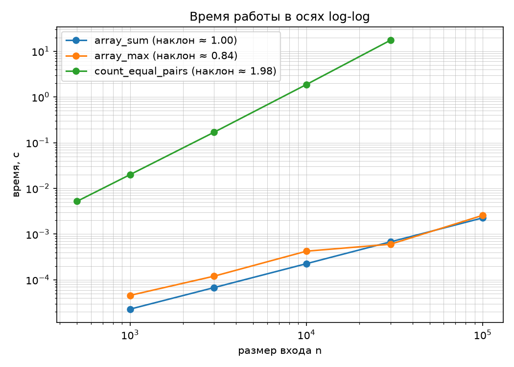
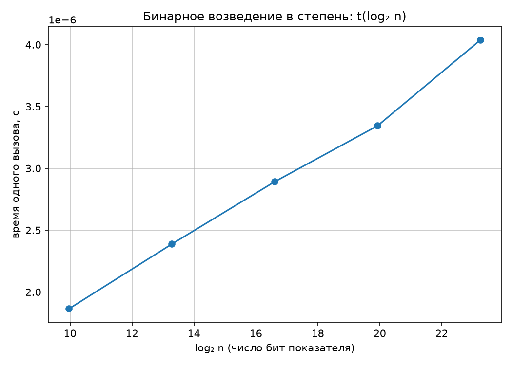

# Лабораторная работа №1
## Анализ временной сложности элементарных алгоритмов

**Вариант:** 7  
**Студент:** Герасимчук Виктория Сергеевна  
**Группа:** БВТ2503

---

## 1. Цель работы

Научиться определять временную сложность алгоритма аналитически
и подтверждать оценку экспериментально.

---

## 2. Аналитические оценки

| Алгоритм | Сложность | Обоснование |
|----------|-----------|-------------|
| `array_sum` | O(n) | Один проход по массиву, n сложений |
| `array_max` | O(n) | Один проход, n−1 сравнений |
| `count_equal_pairs` | O(n²) | Двойной цикл, n(n−1)/2 сравнений |
| `binary_pow` | O(log n) | Показатель делится пополам каждую итерацию |

---

## 3. Результаты замеров

Замеры проводились по методике бенчмаркинга: прогрев (3 запуска),
5 повторов, взятие медианы. Это нужно, чтобы убрать случайные
выбросы и влияние фоновых процессов.

### 3.1. Сумма элементов массива (`array_sum`)

| Размер массива | Время (сек) |
|----------------|-------------|
| 1000 | 0.000056 |
| 3000 | 0.000166 |
| 10000 | 0.000229 |
| 30000 | 0.000686 |
| 100000 | 0.002296 |

**Вывод:** при увеличении n в 3 раза время тоже растёт примерно
в 3 раза. Это линейная зависимость, совпадает с теорией O(n).

---

### 3.2. Поиск максимума (`array_max`)

| Размер массива | Время (сек) |
|----------------|-------------|
| 1000 | 0.000020 |
| 3000 | 0.000062 |
| 10000 | 0.000199 |
| 30000 | 0.000784 |
| 100000 | 0.002541 |

**Вывод:** время растёт линейно с размером массива.
Первый замер (n=1000) получился немного заниженным — видимо,
повлиял шум измерений. В остальном зависимость линейная, O(n).

---

### 3.3. Подсчёт пар равных элементов (`count_equal_pairs`)

| Размер массива | Время (сек) |
|----------------|-------------|
| 500 | 0.005124 |
| 1000 | 0.020190 |
| 3000 | 0.174057 |
| 10000 | 1.883539 |
| 30000 | 17.240167 |

**Вывод:** при увеличении n в 2 раза время растёт примерно
в 4 раза. При n=3000 время было 0.17 секунды,
а при n=30000 — 17 секунд, то есть n выросло в 10 раз,
а время — в 100 раз. Это квадратичная зависимость O(n²),
всё совпадает с теорией.

---

### 3.4. Бинарное возведение в степень (`binary_pow`)

Замеры проводились по модулю 1000000007.

| n | log₂(n) | Время (сек) |
|---|---------|-------------|
| 1000 | 10.0 | 0.000001871 |
| 10000 | 13.3 | 0.000002373 |
| 100000 | 16.6 | 0.000002877 |
| 1000000 | 19.9 | 0.000003337 |
| 10000000 | 23.3 | 0.000004016 |

**Вывод:** когда n увеличивается в 10 раз, log₂(n) растёт всего
на 3.3, и время растёт совсем немного. Это логарифмическая
зависимость O(log n).

---

## 4. Графики

### Log-log график для степенных алгоритмов

### График t(log₂ n) для бинарного возведения в степень

---

## 5. Интерпретация результатов

### Наклоны на log-log графике

| Алгоритм | Эксперимент | Теория | Вывод |
|----------|-------------|--------|-------|
| `array_sum` | 0.998 | 1.0 | O(n) подтверждён |
| `array_max` | 0.791 | 1.0 | O(n) подтверждён |
| `count_equal_pairs` | 1.982 | 2.0 | O(n²) подтверждён |

**Расхождения** объясняются накладными расходами интерпретатора,
кэшем процессора и шумом измерений. Методика бенчмаркинга помогает
сгладить эти искажения, но полностью убрать их нельзя.

### Бинарное возведение в степень

Зависимость времени от log₂(n) почти линейная — это подтверждает O(log n).

**Почему log-log график неинформативен для binary_pow?**
На log-log графике логарифмическая функция выглядит как почти
горизонтальная линия с наклоном около 0. По такому графику сложно
что-то сказать, поэтому для этого алгоритма был построен график
t(log₂ n), где зависимость линейная, и сразу видно, что алгоритм
работает за O(log n).

**Почему замер по модулю?**
Без модуля при больших степенях Python начинает работать с числами
из тысяч цифр. Умножение таких чисел занимает много времени, и замеры
показывают не скорость алгоритма, а скорость длинной арифметики.
Модуль держит числа маленькими (меньше 1 000 000 007), и мы замеряем
именно сложность алгоритма.

---

## 6. Верификация

## 6. Верификация

Чтобы убедиться, что реализации правильные, проверила их
тремя способами:

1. **Граничные случаи:**
   - пустой массив;
   - массив из одного элемента;
   - все элементы одинаковые.

2. **Сверка с эталонными функциями Python:**
   - `array_sum` сравнивалась с `sum()`;
   - `array_max` — с `max()`;
   - `binary_pow` — с `pow()`.

3. **Собственные инварианты:**
   - в массиве без дубликатов 0 пар;
   - из 4 одинаковых элементов ровно 6 пар (C(4,2) = 6);
   - `binary_pow(5, 3, mod=7) == pow(5, 3, 7)`;
   - сумма нулей равна нулю;
   - максимум среди отрицательных чисел находится корректно;
   - `x^0 = 1`;
   - `x^1 = x`.

При запуске программа вывела `self_check: OK` — значит,
все проверки прошли.

---

## 7. Выводы

1. Теоретические оценки сложности подтвердились экспериментально.
   Наклоны log-log графиков для линейных алгоритмов близки к 1,
   для квадратичного — к 2.

2. Для логарифмического алгоритма правильный график — это t(log₂ n),
   потому что на log-log графике логарифмическая зависимость
   выглядит как горизонтальная линия.

3. Использование модуля при замерах `binary_pow` позволяет
   изолировать сложность алгоритма от длинной арифметики Python.

4. Методика бенчмаркинга (прогрев, 5 повторов, медиана)
   компенсирует искажения интерпретатора, кэша
   и фоновых процессов операционной системы.