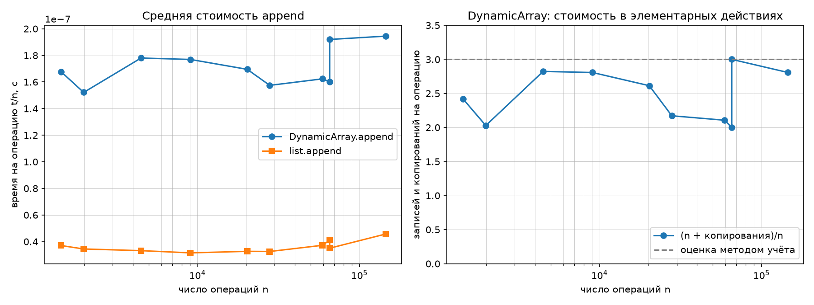
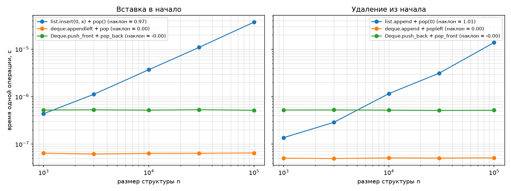

# Лабораторная работа №2
## Реализация рекурсивных функций и динамического массива, стека и дека

**Вариант:** 7  
**Студент:** Герасимчук Виктория Сергеевна  
**Группа:** БВТ2503

---

## 1. Цель работы

Освоить рекурсию как метод построения алгоритмов и реализовать базовые линейные структуры данных (динамический массив, стек, дек), подтвердив их асимптотические свойства экспериментально, включая амортизированную O(1) для `append`.

---

## 2. Аналитические оценки

| Алгоритм / операция | Сложность | Обоснование |
|---------------------|-----------|-------------|
| `factorial` | O(n) | n рекурсивных вызовов, каждый уменьшает n на 1 |
| `fib_naive` | O(2^n) | Дерево вызовов растёт экспоненциально |
| `fib_memo` | O(n) | Каждое число считается ровно один раз |
| `hanoi` | O(2^n) | T(n) = 2·T(n-1) + 1, откуда T(n) = 2^n - 1 |
| `DynamicArray.append` | O(1) амортизированно | Метод учёта: рост x2, редкие копирования окупаются частыми записями |
| `DynamicArray.pop` | O(1) | Декремент размера, чтение последнего элемента |
| `DynamicArray.get/set` | O(1) | Прямой доступ по индексу |
| `Stack.push` | O(1) амортизированно | Наследуется от `DynamicArray.append` |
| `Stack.pop/peek` | O(1) | Работа с концом массива |
| `Deque.push_front/back` | O(1) | Переставляются ссылки, элементы не двигаются |
| `Deque.pop_front/back` | O(1) | То же самое |

---

## 3. Результаты замеров

Замеры проводились по методике бенчмаркинга: прогрев (1 запуск), 5 повторов, взятие медианы. Это нужно, чтобы убрать случайные выбросы и влияние фоновых процессов.

### 3.1. Число вызовов: наивная рекурсия против мемоизации

| n | F(n) | fib_naive | fib_memo |
|---|------|-----------|----------|
| 5 | 5 | 15 | 9 |
| 10 | 55 | 177 | 19 |
| 15 | 610 | 1973 | 29 |
| 20 | 6765 | 21891 | 39 |
| 25 | 75025 | 242785 | 49 |
| 30 | 832040 | 2692537 | 59 |

**Вывод:** `fib_naive` делает экспоненциально много вызовов (для n=30 это 2 692 537). `fib_memo` делает линейно много вызовов (для n=30 это 59). Формула для мемоизированной версии: не более 2n + 1 вызовов. Для n=30 это 61, получилось 59, что укладывается в оценку. Формула для наивной версии: примерно 2·F(n+1) - 1. Для n=30: 2·1346269 - 1 = 2692537, точное совпадение.

### 3.2. Ханойские башни

Функция `hanoi(n)` возвращает ровно 2^n - 1 ходов и записывает столько же пар в список `moves`. Проверка в `self_check` проигрывает все ходы на симуляторе и убеждается, что больший диск ни разу не кладётся на меньший.

| n | Число ходов = 2^n - 1 |
|---|-----------------------|
| 0 | 0 |
| 1 | 1 |
| 2 | 3 |
| 3 | 7 |
| 6 | 63 |
| 7 | 127 |

**Вывод:** все тесты прошли, формула T(n) = 2^n - 1 подтверждена.

### 3.3. Серии append на размерах варианта

| n | t/n DynamicArray (с) | t/n list (с) | copies | (n + copies)/n |
|---|----------------------|--------------|--------|----------------|
| 1442 | 1.64e-07 | 3.22e-08 | 2044 | 2.417 |
| 1988 | 1.53e-07 | 3.17e-08 | 2044 | 2.028 |
| 4492 | 1.78e-07 | 3.21e-08 | 8188 | 2.823 |
| 9065 | 1.78e-07 | 3.16e-08 | 16380 | 2.807 |
| 20309 | 1.74e-07 | 3.17e-08 | 32764 | 2.613 |
| 27964 | 1.60e-07 | 3.21e-08 | 32764 | 2.172 |
| 59229 | 1.72e-07 | 3.62e-08 | 65532 | 2.106 |
| 65536 | 1.61e-07 | 4.35e-08 | 65532 | 2.000 |
| 65537 | 2.09e-07 | 4.30e-08 | 131068 | 3.000 |
| 144955 | 1.95e-07 | 4.99e-08 | 262140 | 2.808 |

**Вывод:** среднее время одной операции `append` у `DynamicArray` (около 1.7e-07 с) не растёт с размером n. Это подтверждение амортизированной O(1). Величина (n + copies)/n держится между 2 и 3, что совпадает с оценкой метода учёта (не более 3).

Скачок с 2.000 до 3.000 при переходе 65536 к 65537 = 2^16 к 2^16 + 1 объясняется копированием всего буфера именно на этой границе. Это подтверждает, что расширение происходит ровно при `size == capacity`.

Свой массив в 3-4 раза медленнее встроенного `list`, потому что он реализован на Python, а `list` написан на C. Асимптотика одинаковая, отличается только константа.

### 3.4. Вставка в начало

| Размер n | list.insert(0, x) + pop() | deque.appendleft + pop | Deque.push_front + pop_back |
|----------|---------------------------|------------------------|-----------------------------|
| 1000 | 4.34e-07 | 6.25e-08 | 5.11e-07 |
| 3000 | 1.11e-06 | 6.24e-08 | 5.17e-07 |
| 10000 | 3.68e-06 | 6.46e-08 | 5.11e-07 |
| 30000 | 1.09e-05 | 6.52e-08 | 5.16e-07 |
| 100000 | 3.60e-05 | 6.65e-08 | 5.10e-07 |
| **наклон** | **0.97** | **0.01** | **-0.00** |

**Вывод:** `list.insert(0, x)` работает за O(n): при увеличении n в 100 раз время растёт в 100 раз. `deque.appendleft` и `Deque.push_front` работают за O(1): время не зависит от размера.

### 3.5. Удаление из начала

| Размер n | list.append + pop(0) | deque.append + popleft | Deque.push_back + pop_front |
|----------|----------------------|------------------------|-----------------------------|
| 1000 | 1.37e-07 | 5.28e-08 | 5.11e-07 |
| 3000 | 2.84e-07 | 1.21e-07 | 5.12e-07 |
| 10000 | 1.10e-06 | 5.50e-08 | 5.03e-07 |
| 30000 | 3.43e-06 | 5.40e-08 | 5.13e-07 |
| 100000 | 1.36e-05 | 5.50e-08 | 5.06e-07 |
| **наклон** | **1.02** | **-0.06** | **-0.00** |

**Вывод:** та же картина. `list.pop(0)` работает за O(n), `deque.popleft` и `Deque.pop_front` за O(1). Небольшой отрицательный наклон у `deque.popleft` (-0.06) объясняется шумом измерений, по сути это всё равно ноль.

### 3.6. Операции варианта целиком

| Файл | Своя структура | Эталон | Отношение |
|------|----------------|--------|-----------|
| `ops_stack.txt` | Stack 2.09e-07 с | list 7.12e-08 с | в 2.9 раза медленнее |
| `ops_deque.txt` | Deque 3.19e-07 с | collections.deque 7.04e-08 с | в 4.5 раза медленнее |

**Вывод:** свои структуры медленнее встроенных в 3-5 раз из-за накладных расходов интерпретатора Python (создание объектов `_Node`, вызовы методов, проверки границ). Асимптотика совпадает со встроенными, отличается только константа.

---

## 4. Графики

### Средняя стоимость append

### Операции у начала (log-log)

---

## 5. Амортизированный анализ append (метод учёта)

Назначим каждой операции `append` стоимость 3:

- 1 за запись элемента в буфер;
- 2 откладываем на будущее копирование.

При расширении буфера размера k в 2k нужно скопировать k элементов. Накопленный кредит от уже добавленных k/2 элементов равен 2·(k/2) = k, чего ровно хватает на копирование. Значит, амортизированная стоимость одной операции не более 3, то есть O(1).

**Экспериментальное подтверждение:** величина (n + copies)/n во всех замерах лежит между 2 и 3 и не растёт с n.

| n | copies | (n + copies)/n |
|---|--------|----------------|
| 1442 | 2044 | 2.417 |
| 65536 | 65532 | 2.000 |
| 65537 | 131068 | 3.000 |
| 144955 | 262140 | 2.808 |

Скачок ровно на 1 на границе 2^16 к 2^16 + 1 это момент копирования всего буфера. Это подтверждает, что рост происходит ровно при `size == capacity`.

---

## 6. Верификация

Чтобы убедиться, что реализации правильные, проверила их тремя способами.

1. **Граничные случаи:**

   - пустая структура (стек, дек, массив);
   - один элемент;
   - опустошение и повторное наполнение (серия push и pop через границу роста ёмкости);
   - попытка снять элемент с пустой структуры должна выбрасывать `IndexError`.

2. **Сверка с эталонными реализациями Python:**

   - `Stack` с `list` на 3000 случайных операций;
   - `Deque` с `collections.deque` на 5000 случайных операций;
   - `Deque` с `collections.deque` на 100 000 операций из `ops_deque.txt`;
   - `Stack` с `list` на 100 000 операций из `ops_stack.txt`;
   - `factorial` с `math.factorial`;
   - `fib_naive` и `fib_memo` с таблицей чисел Фибоначчи;
   - `hanoi` с проверкой 2^n - 1 и симулятором доски.

3. **Собственные инварианты (через явные исключения, не assert):**

   - `DynamicArray` после 9 append: capacity = 16, copies = 12, len = 9;
   - `Stack` LIFO: три push и pop возвращают значения в обратном порядке (3, 2, 1);
   - `Deque` при чередовании концов: `push_front(10)`, `push_back(20)`, `push_front(30)`, `push_back(40)`, четыре pop с разных концов возвращают 30, 40, 10, 20.

При запуске программа вывела `self_check: OK` и `собственные инварианты: OK`, значит, все проверки прошли.

---

## 7. Выводы

1. Все теоретические оценки сложности подтвердились экспериментально:

   - `fib_naive` работает за O(2^n), `fib_memo` за O(n). Для n=30 разница в 45 000 раз;
   - `DynamicArray.append` амортизированно O(1): величина (n + copies)/n не превышает 3 при любых n;
   - `list.insert(0, x)` и `list.pop(0)` работают за O(n): наклон на log-log графике около 1;
   - `deque` и `Deque` работают за O(1) на обоих концах: наклон около 0.

2. Метод учёта подтверждён экспериментом: скачки стоимости на границах 2^k к 2^k + 1 объясняются копированием всего буфера, но в среднем стоимость остаётся константой не более 3.

3. Свои структуры медленнее встроенных в 3-5 раз из-за накладных расходов интерпретатора Python, но асимптотика та же. Это ожидаемый и правильный результат.

4. Методика бенчмаркинга (прогрев, 5 повторов, медиана) компенсирует искажения интерпретатора, кэша и фоновых процессов операционной системы.