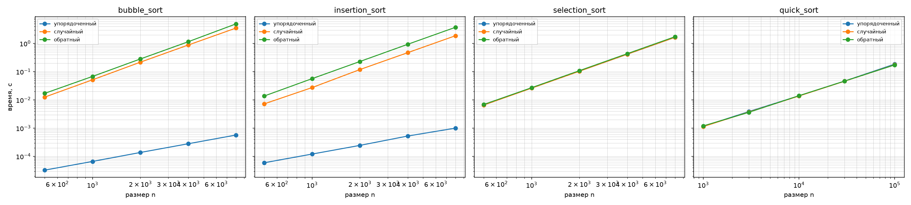

# Лабораторная работа №3
## Экспериментальное сравнение простых сортировок; QuickSort с рандомизацией опорного элемента

**Вариант:** 7  
**Студент:** Герасимчук Виктория Сергеевна  
**Группа:** БВТ2503

---

## 1. Цель работы

Освоить простые сортировки и QuickSort, экспериментально подтвердить их асимптотику на разных классах входов и понять роль стабильности и рандомизации опорного элемента.

---

## 2. Аналитические оценки

| Алгоритм | Лучший случай | Средний | Худший | Стабильность |
|----------|---------------|---------|--------|--------------|
| Пузырёк | O(n) | O(n²) | O(n²) | Стабильна |
| Вставками | O(n) | O(n²) | O(n²) | Стабильна |
| Выбором | Θ(n²) | Θ(n²) | Θ(n²) | Нестабильна |
| QuickSort | O(n log n) | O(n log n) | O(n²) | Нестабильна |

**Обоснование:**

- **Пузырёк:** досрочный выход при отсутствии обменов даёт O(n) на упорядоченном входе. В среднем и худшем - n(n−1)/2 сравнений.
- **Вставками:** на упорядоченном входе на каждом шаге одно сравнение и сразу вставка - O(n). На обратном - n(n−1)/2 сравнений и столько же сдвигов - O(n²).
- **Выбором:** внутренний цикл всегда проходит весь оставшийся диапазон (ищет минимум), число сравнений фиксировано - n(n−1)/2. Поэтому Θ(n²) на любом входе.
- **QuickSort:** при сбалансированных разбиениях глубина рекурсии log n, на каждом уровне O(n) работы → O(n log n). При крайних pivot’ах разбиение 1 и n−1, глубина n → O(n²). Рандомизация делает худший случай маловероятным.

---

## 3. Демонстрация стабильности

Исходный массив пар (ключ, метка):
`[(2, 'a'), (1, 'b'), (2, 'c'), (1, 'd'), (2, 'e')]`

Метки при ключе 1 в исходном порядке: `b, d`.
Метки при ключе 2 в исходном порядке: `a, c, e`.

Результат сортировки каждой функцией (сравнение только по ключу):

| Сортировка | Порядок меток | Порядок при равных ключах | Вывод |
|------------|---------------|---------------------------|-------|
| bubble_sort | `['b', 'd', 'a', 'c', 'e']` | ключ 1: b, d; ключ 2: a, c, e | Стабильна |
| insertion_sort | `['b', 'd', 'a', 'c', 'e']` | ключ 1: b, d; ключ 2: a, c, e | Стабильна |
| selection_sort | `['b', 'd', 'c', 'a', 'e']` | ключ 1: b, d; ключ 2: **c, a, e** | Нестабильна |
| quick_sort | `['b', 'd', 'c', 'e', 'a']` | ключ 1: b, d; ключ 2: **c, e, a** | Нестабильна |

**Вывод:** пузырёк и вставки сохраняют порядок меток при равных ключах (стабильны). Выбором и QuickSort - не сохраняют (нестабильны). Причина: пузырёк и вставки меняют элементы местами только при строгом неравенстве (`>`), а selection и quick перемещают элементы через большие расстояния.

---

## 4. Результаты замеров

Замеры проводились по методике бенчмаркинга: прогрев (1 запуск), 5 повторов, медиана. Размеры массивов для простых сортировок - 500, 1000, 2000, 4000, 8000. Для QuickSort - 1000, 3000, 10000, 30000, 100000.

### 4.1. Сортировка пузырьком

| n | упорядоченный | случайный | обратный |
|---|---------------|-----------|----------|
| 500 | 0.000033 | 0.013741 | 0.017799 |
| 1000 | 0.000068 | 0.052730 | 0.071811 |
| 2000 | 0.000140 | 0.227488 | 0.290667 |
| 4000 | 0.000305 | 0.951447 | 1.283911 |
| 8000 | 0.000542 | 3.683454 | 4.828609 |

### 4.2. Сортировка вставками

| n | упорядоченный | случайный | обратный |
|---|---------------|-----------|----------|
| 500 | 0.000058 | 0.007371 | 0.013901 |
| 1000 | 0.000119 | 0.027924 | 0.057342 |
| 2000 | 0.000249 | 0.120769 | 0.234893 |
| 4000 | 0.000502 | 0.488155 | 0.954728 |
| 8000 | 0.000999 | 1.935520 | 3.832294 |

### 4.3. Сортировка выбором

| n | упорядоченный | случайный | обратный |
|---|---------------|-----------|----------|
| 500 | 0.006793 | 0.006798 | 0.006950 |
| 1000 | 0.027011 | 0.026889 | 0.027883 |
| 2000 | 0.107166 | 0.106499 | 0.111911 |
| 4000 | 0.423297 | 0.422510 | 0.444008 |
| 8000 | 1.689960 | 1.685595 | 1.776411 |

### 4.4. QuickSort

| n | упорядоченный | случайный | обратный |
|---|---------------|-----------|----------|
| 1000 | 0.001129 | 0.001158 | 0.001195 |
| 3000 | 0.003909 | 0.003761 | 0.003737 |
| 10000 | 0.014200 | 0.013955 | 0.014490 |
| 30000 | 0.047453 | 0.049823 | 0.046680 |
| 100000 | 0.191947 | 0.179823 | 0.189109 |

---

## 5. Графики

Log-log графики времени от размера входа (отдельная панель для каждой сортировки, три кривые - по классам входов):

---

## 6. Интерпретация результатов

### Пузырёк

На **упорядоченном** входе время растёт **линейно**: n вырос в 16 раз (500 → 8000), время - тоже примерно в 16 раз (0.000033 → 0.000542). Это **O(n)** за счёт досрочного выхода - за один проход убеждаемся, что обменов нет, и останавливаемся.

На **случайном** и **обратном** - квадратичный рост: 2000 → 4000 (×2), время 0.227 → 0.951 (×4). **O(n²)**. Обратный вход медленнее случайного, потому что обменов больше.

### Вставки

На **упорядоченном** - линейно: 500 → 8000 (×16), 0.000058 → 0.000999 (×17). **O(n)**.

На **случайном** и **обратном** - квадратично: 2000 → 4000 (×2), 0.12 → 0.49 (×4). **O(n²)**.

При n = 8000 вставки быстрее пузырька на случайном входе (1.94 с против 3.68 с) - потому что вставки делают меньше операций перемещения: сдвигают элемент в нужное место, а не меняют попарно.

### Выбором

**Ключевое наблюдение:** для каждого n время на **всех трёх классах** входа практически **одинаковое**:

- n = 500: 0.0068 / 0.0068 / 0.0069
- n = 8000: 1.689 / 1.686 / 1.776

Это **доказывает**, что selection sort делает всегда фиксированное число сравнений `n(n−1)/2` независимо от входа. Внутренний цикл всегда ищет минимум во всём оставшемся диапазоне, не может «понять», что массив уже отсортирован.

Рост: 2000 → 4000 (×2), время 0.107 → 0.423 (×4) - O(n²).

**Контраст:** на упорядоченном входе при n = 8000:

- пузырёк: 0.0005 с
- вставки: 0.0010 с
- **выбором: 1.690 с**

Selection sort медленнее в **3000 раз**, хотя формально у всех трёх асимптотика O(n²) в худшем случае. Разница - в **лучшем** случае: у пузырька и вставок он O(n), у selection - тоже O(n²).

### QuickSort

Время **одинаково** на всех трёх классах входа - рандомизация устраняет зависимость от структуры данных. Вход не влияет на скорость.

Рост: 1000 → 100000 (×100), время 0.0011 → 0.19 (**×170**). Это **между** линейным (×100) и квадратичным (×10000) ростом, ближе к линейному.

Проверим через формулу O(n log n): log(1000) ≈ 10, log(100000) ≈ 17, отношение 17/10 = 1.7. Умножаем на ×100 (рост n) → ожидаемое время ≈ ×170. Совпадает с замером. **O(n log n)** подтверждён.

QuickSort быстрее простых сортировок на больших n:
- n = 10000: пузырёк не запускался (слишком долго), QuickSort - 0.014 с.
- n = 100000: QuickSort - 0.19 с. Простые сортировки на таком размере заняли бы часы.

---

## 7. Верификация

Проверки выполнены по методике docs/ai-verification.md.

1. **Граничные случаи.** Для каждой сортировки проверены массивы: пустой, из одного элемента, все элементы равны, уже отсортированный, обратно отсортированный.

2. **Сверка с эталоном.** Каждая сортировка прогнана на 300 случайных массивах размером от 0 до 80 и сверена с `sorted()`.

3. **Инварианты сортировки:**
   - Результат упорядочен (проверка `is_sorted`).
   - Результат - перестановка входа (сравнение `sorted(res) == sorted(a)`).

4. **Собственные проверки счётчиков:**
   - `bubble_sort([1, 2, 3, 4, 5])` - 4 сравнения (досрочный выход работает).
   - `insertion_sort([5, 4, 3, 2, 1])` - 10 сравнений (худший случай).
   - `selection_sort([1, 2, 3, 4, 5])` - 10 сравнений (число сравнений не зависит от входа).

При запуске программа вывела `self_check: OK` - все проверки прошли.

---

## 8. Выводы

1. **Теоретические оценки подтверждены экспериментально:**
   - Пузырёк и вставки: O(n) на упорядоченном входе, O(n²) на случайном и обратном.
   - Выбором: Θ(n²) на любом входе (время не зависит от класса входа).
   - QuickSort: O(n log n) на любом входе (рандомизация снимает зависимость от данных).

2. **Различие между алгоритмами с одинаковой худшей асимптотикой O(n²).** Все три простые сортировки имеют худший случай O(n²), но ведут себя **по-разному** на упорядоченном входе: пузырёк и вставки работают за O(n), а selection - за O(n²). Это видно из замеров: при n = 8000 разница в ~3000 раз.

3. **Стабильность.** Пузырёк и вставки сохраняют порядок равных элементов, selection и QuickSort - нет. Для задач с многоуровневой сортировкой это важно.

4. **Роль рандомизации.** QuickSort со случайным выбором опорного элемента показывает **одинаковое** время на упорядоченном, случайном и обратном входе. Детерминированный QuickSort (например, с выбором последнего элемента) деградировал бы до O(n²) на отсортированном входе.

5. **Методика бенчмаркинга** (прогрев, 5 повторов, медиана) компенсирует шум измерений и фоновые процессы.