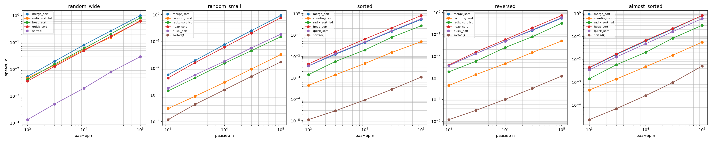

# Лабораторная работа №4
## MergeSort, Counting Sort, Radix Sort, HeapSort

**Вариант:** 7  
**Студент:** Герасимчук Виктория Сергеевна  
**Группа:** БВТ2503

---

## 1. Цель работы

Реализовать алгоритмы сортировки (MergeSort, Counting Sort, Radix Sort, HeapSort), экспериментально сравнить их с QuickSort и встроенной функцией `sorted()`, определить границы применимости каждого алгоритма.

---

## 2. Аналитические оценки

| Алгоритм | Время (среднее) | Время (худшее) | Доп. память | Стабильность | Ограничения |
|---|---|---|---|---|---|
| MergeSort | O(n log n) | O(n log n) | O(n) | Да | Требует дополнительной памяти |
| Counting Sort | O(n + k) | O(n + k) | O(k) | Да | Только целые числа с небольшим диапазоном `k` |
| Radix Sort | O(d·(n + b)) | O(d·(n + b)) | O(n + b) | Да | Только целые неотрицательные числа |
| HeapSort | O(n log n) | O(n log n) | O(1) | Нет | Работает на месте |
| QuickSort | O(n log n) | O(n²) | O(log n) | Нет | Зависит от выбора опорного элемента |
| Timsort (`sorted`) | O(n log n) | O(n log n) | O(n) | Да | Встроенная, написана на C |

*Примечание:* `n` - размер массива, `k` - диапазон ключей, `d` - число разрядов, `b` - основание системы счисления (для Radix Sort).

---

## 3. Верификация

В заготовке реализованы проверки (результат `self_check: OK`):
1. Граничные случаи (пустой массив, один элемент, все элементы равны, отсортированный, обратный порядок).
2. Сверка с `sorted()` на 200 случайных массивах.
3. Свойство кучи после фазы построения.
4. Стабильность MergeSort на массиве пар (ключ, метка).

---

## 4. Результаты замеров

Замеры: 5 повторов, медиана, с прогревом. Размер массива `n = 100 000`.

| Распределение | MergeSort | Counting | Radix | Heap | Quick | `sorted()` |
|---|---|---|---|---|---|---|
| random_wide | 0.989 | - | 0.576 | 0.838 | 0.618 | 0.031 |
| random_small | 0.952 | **0.035** | 0.159 | 0.776 | 0.192 | 0.018 |
| sorted | 0.540 | 0.050 | 0.282 | 0.801 | 0.581 | **0.002** |
| reversed | 0.560 | 0.048 | 0.329 | 0.735 | 0.591 | 0.001 |
| almost_sorted | 0.791 | 0.052 | 0.281 | 0.809 | 0.584 | 0.008 |

*Примечание:* Counting Sort пропущен на `random_wide`, так как диапазон ключей (10^9) не позволяет выделить массив счётчиков в памяти.

---

## 5. Обсуждение результатов

**Сравнение алгоритмов:**
1. **Counting Sort** - абсолютный лидер на узком диапазоне (в 27 раз быстрее MergeSort на `random_small`). Это следствие сложности O(n + k), где k мало.
2. **Radix Sort** - эффективнее MergeSort в 1.7 раза на широком диапазоне, так как не требует сравнений и работает за фиксированное число проходов (d = 10 для чисел до 10^9).
3. **HeapSort** - стабильно медленнее остальных. Причина: плохая локальность кэша из-за прыжков по индексам при просеивании кучи.
4. **QuickSort** - показывает O(n log n) на всех распределениях, рандомизация опорного элемента предотвращает деградацию до O(n²).
5. **Timsort (`sorted()`)** - быстрее любой реализации на Python в 5–30 раз. Использует гибрид слияния и вставок, адаптируется к уже отсортированным данным, написан на C.

---

## 6. Графики

---

## 7. Выводы

1. Все реализованные алгоритмы работают корректно, проходят тесты на инварианты и сверку с эталоном.
2. Асимптотические оценки подтверждены: MergeSort и HeapSort стабильно O(n log n), Counting Sort - O(n + k) на узком диапазоне.
3. Ограничения подтверждены на практике: Counting Sort не работает на широком диапазоне, Radix Sort требует неотрицательных целых.
4. Рандомизация QuickSort предотвращает худший случай O(n²) даже на обратном порядке.
5. Встроенная функция `sorted()` вне конкуренции за счёт оптимизаций на уровне C.